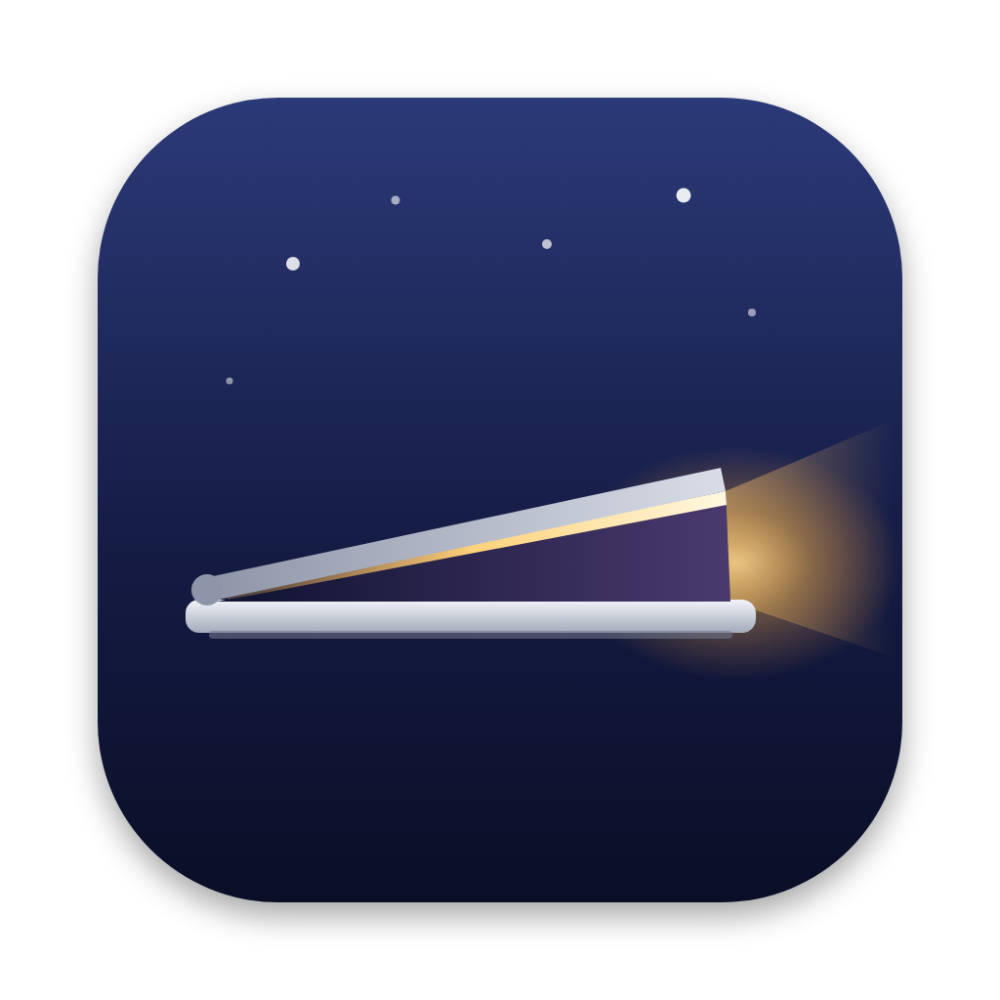

<p align="center">
  
</p>

<h1 align="center">Ajar</h1>

<p align="center">
  <strong>Keep your Mac awake with the lid closed, safely.</strong><br>
  A tiny, open-source menu bar app for downloads, builds, renders and anything else that needs to finish while your laptop is shut.
</p>

<p align="center">
  <a href="https://github.com/mahit-c/ajar/releases/latest"></a>
  
  <a href="LICENSE"></a>
  <a href="https://github.com/mahit-c/ajar/actions/workflows/build.yml"></a>
</p>

> [!WARNING]
> Ajar is in **early beta**. Builds are not yet signed or notarized by Apple, so macOS will warn you the first time you open it (see [Install](#install)).

---

## Why Ajar?

Most keep-awake apps (and `caffeinate`) stop your Mac idling to sleep, but **closing the lid still puts a MacBook to sleep** unless you're plugged into an external display. The usual workaround, `sudo pmset -a disablesleep 1`, works but is easy to forget. Your Mac then never sleeps again, possibly while it sits in a bag.

Ajar gives you that same switch, plus the safety rails it lacks:

- **One click, lid closed.** Start for 15 minutes to 8 hours, or indefinitely, from the menu bar.
- **Can't get stuck on.** Sleep is restored automatically when you quit, if Ajar crashes or hangs, or after a reboot mid-session.
- **Won't cook your Mac in a bag.** Ajar stops at a battery temperature you choose (default 45 °C) and warns you 5 °C before it gets there. It also stops when macOS reports the Mac running hot.
- **Still locks when you close the lid.** Normally closing the lid sleeps and locks your Mac. Ajar keeps the lock (everything keeps running behind it), so a closed laptop can't be opened by someone else. It's skipped when you use an external display.
- **Battery aware.** Stops below a battery level (default 20%), and optionally when you unplug.
- **Survives power changes.** It re-applies itself when you plug in or unplug, a common failure point for other closed-lid tools on Apple Silicon.
- **Tells you the truth.** The menu shows the real system state, not what the app assumes, and fixes itself if the state drifts.
- **No extra downloads.** It's one app with one helper, and the helper can do exactly one thing.
- **Private.** No analytics, no network access, no accounts.

<!-- TODO: add screenshots -->
<p align="center">
  
  &nbsp;&nbsp;
  
</p>

## Install

### Download

1. Download **Ajar.zip** from the [latest release](https://github.com/mahit-c/ajar/releases/latest) and move **Ajar.app** to `/Applications`.
2. Open it. While builds are unsigned, macOS will block it the first time. Go to **System Settings → Privacy & Security** and click **Open Anyway**.
3. Turn Ajar on. The first time, it asks for your password to install its helper (see [Is it safe?](#is-it-safe)).

### Build from source

Requires macOS 13+ and the Xcode Command Line Tools (`xcode-select --install`).

```bash
git clone https://github.com/mahit-c/ajar.git
cd ajar
scripts/build.sh
open build/Ajar.app
```

Homebrew cask: coming once releases are signed.

## Usage

Click the menu bar icon (it shows a moon while off and a sun while on):

- **Keep Awake Indefinitely** or **Keep Awake For…** starts a session. Close the lid and your Mac keeps running.
- **Stop — Let Mac Sleep** ends it. Quitting Ajar always ends it too.
- **Safety** sets the temperature limit, low-battery level, stop when unplugged and thermal protection.
- **Settings… (⌘,)** opens the full window. If the menu bar icon is hidden (behind the notch, or by a menu bar manager), open Ajar again from Finder or Spotlight to get here.

## FAQ

<details id="is-it-safe">
<summary><strong>Is it safe? Why does it need my password?</strong></summary>

macOS only allows a process running as root to keep a closed laptop awake. Ajar installs a small helper that exposes exactly two actions over XPC: *disable sleep* and *restore sleep*. It never runs anything else. It only accepts connections from the Ajar app, and it restores normal sleep whenever the app quits, disconnects, stops sending a heartbeat for 60 seconds, the battery reaches 55 °C or drops to 5%, or macOS reports a critical thermal state. Those backstops apply even if you turn the app's own limits off. Every system call it makes is time-limited, so a stuck command can't stop it restoring sleep. The helper is about 200 lines: [`Sources/AjarHelper/main.swift`](Sources/AjarHelper/main.swift).
</details>

<details>
<summary><strong>Does it work on battery? Without an external display?</strong></summary>

Yes to both. That's the point. Mind the heat: a closed laptop in a bag can't cool itself, which is why the temperature limit is on by default.
</details>

<details>
<summary><strong>What happens if Ajar crashes?</strong></summary>

The helper notices that the app has disconnected and restores normal sleep straight away. If the whole Mac restarts mid-session, the helper restores sleep at boot.
</details>

<details>
<summary><strong>How is this different from Caffeine, Amphetamine or KeepingYouAwake?</strong></summary>

Caffeine and KeepingYouAwake prevent idle sleep but don't keep a MacBook awake with the lid closed. Amphetamine can, and it has far more features (triggers, hotkeys, AppleScript), so if you need those it's a great choice. Ajar focuses on doing closed-lid mode reliably and safely:

| | Ajar | Amphetamine | Caffeine / KeepingYouAwake |
|---|:-:|:-:|:-:|
| Awake with the lid closed | ✅ | ✅ (add-on scripts on Apple Silicon) | ❌ |
| Stops at a battery temperature you choose | ✅ | ❌ | ❌ |
| Warns before it gets too hot | ✅ | ❌ | ❌ |
| Stops when macOS reports the Mac running hot | ✅ | ❌ | ❌ |
| Stops at low battery | ✅ | ✅ | ❌ |
| Restores sleep after a crash or reboot | ✅ | With the separate Enhancer | n/a |
| One install, no extra scripts | ✅ | ❌ | ✅ |
| Open source | ✅ | ❌ | ✅ |
| Triggers (Wi-Fi, displays, apps, schedule…) | ❌ | ✅ | ❌ |
| Hotkeys, AppleScript | Not yet | ✅ | Partial |
</details>

<details>
<summary><strong>Intel Macs?</strong></summary>

Building from source works on both architectures. Universal release builds are on the roadmap.
</details>

<details>
<summary><strong>How do I uninstall it completely?</strong></summary>

Open **Settings → Helper → Uninstall…**, then delete Ajar.app. If something went wrong, run [`scripts/uninstall.sh`](scripts/uninstall.sh). It removes the helper and runs `pmset -a disablesleep 0`.
</details>

## Known limitations

- **Beta.** Tested on macOS 26 on Apple Silicon so far. Reports from other macOS versions and Macs are very welcome.
- **One user at a time.** With fast user switching, one user stopping Ajar can end another user's session.
- **Screen lock uses a private macOS call** (the one behind ⌃⌘Q), because there's no public API. If a future macOS removes it, Ajar falls back to turning the display off, which locks according to your *Require password* setting.

## How it works

```
Ajar.app (menu bar, runs as you)  ──XPC──▶  AjarHelper (LaunchDaemon, root)
  timers, safety rules,                       runs only: pmset -a disablesleep 0|1
  heartbeat every 5s                          reverts on disconnect, missed heartbeat,
                                              55 °C, critical thermal, or reboot
```

See [CONTRIBUTING.md](CONTRIBUTING.md) for the code layout, local development and the release process.

## Roadmap

- [ ] Signed and notarized releases
- [ ] Universal (Apple Silicon + Intel) builds
- [ ] Auto-updates (Sparkle)
- [ ] Homebrew cask
- [ ] `ajar run -- <command>`: stay awake only while a command runs
- [ ] Shortcuts and URL scheme support

## Contributing

Bug reports, ideas and pull requests are welcome. Please read [CONTRIBUTING.md](CONTRIBUTING.md). For bug reports, use **Settings → Helper → Copy Diagnostics** and paste the result into the issue. To report a security issue, see [SECURITY.md](SECURITY.md).

## Acknowledgements

Inspired by [Caffeine](https://www.caffeine-app.net), [KeepingYouAwake](https://github.com/newmarcel/KeepingYouAwake) and [Amphetamine](https://apps.apple.com/app/amphetamine/id937984704). Ajar is an independent project and isn't affiliated with any of them.

## License

[MIT](LICENSE) © 2026 mahit-c
